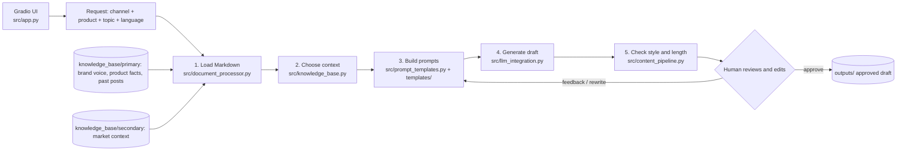

# AI Content Creator

A content tool for Canyon Bicycles' marketing team. A marketer selects a channel, product, topic and language; the app combines Canyon's voice and product knowledge with a prompt template to generate a draft. The marketer reviews, edits, rewrites with feedback, and approves the draft for saving. Replace the knowledge-base files to adapt the tool to another company.

**Demo client:** Canyon Bicycles · **Channels:** email, instagram, linkedin, newsletter · **Products:** gravel, road, mountain bikes · **Languages:** English, German, French, Spanish

---

## How it works (process map)



| Step | File | Card | Must |
|---|---|---|---|
| 1. Load KB Markdown | `src/document_processor.py` | 3.1 | M1, M2 |
| 2. Choose request context | `src/knowledge_base.py` | 3.2 | M3 support |
| 3. Build channel and language prompts | `src/prompt_templates.py`, `templates/` | 4.2 | M4 |
| 4. Generate a draft | `src/llm_integration.py` | 4.1 | M3 |
| 5. Review, revise, and save | `src/content_pipeline.py`, `src/main.py` | 4.3 | M5 |

**Local command checks:** document processor PASS; knowledge base PASS; prompt templates PASS; CLI usage PASS; Gradio app import PASS. LLM calls were skipped in this review.

## Uniqueness evidence

[uniqueness/comparison.md](uniqueness/comparison.md) compares five requests across the three product families and four channels. It describes a product-grounding advantage in its examples and records style and length failures; it does not claim publication readiness or universal superiority.

## RAG decision

Inject selected knowledge into prompts with rule-based selection; no RAG. See [rag_decision.md](rag_decision.md).

---

## Setup

1. Use Python 3.12.
2. From the repository root, install dependencies:
   ```bash
   pip install -r requirements.txt
   ```
3. Copy `.env.example` to `.env` in the repository root and add your API key locally. The optional model setting defaults to `gpt-4o-mini`. Never commit `.env`.

## Run

Run the CLI from the repository root. The usage is `Usage: python src/main.py <channel> <product> "<topic>" [language]`.

```bash
python src/main.py linkedin gravel "autumn gravel season" German
```

Channels: email, instagram, linkedin, newsletter. Products: gravel, road, mountain. Languages: English, German, French, Spanish. Language is optional and defaults to English. Press Enter to approve and save the draft, or type feedback to request a rewrite.

## Run the Gradio app locally

From the repository root:

```bash
python src/app.py
```

Open [http://localhost:7860](http://localhost:7860). The interface supports draft generation, editing, rewrites with feedback, quality review, and approval for saving.

## Live app on Render

Live app: The Render URL was not supplied in the review answers.

## Repo map

```text
src/
├── document_processor.py   # Load and split Markdown knowledge-base files
├── knowledge_base.py       # Select brand, product, past-post, and secondary context
├── prompt_templates.py     # Fill channel and language prompt templates
├── llm_integration.py      # OpenAI API call
├── content_pipeline.py     # Generate, check, review, and save drafts
├── main.py                 # Terminal entry point
└── app.py                  # Gradio interface
knowledge_base/
│   ├── `knowledge_base/primary/brand_guidelines.md`
│   ├── `knowledge_base/primary/past_content/post_gravel_grail_gen3.md`
│   ├── `knowledge_base/primary/past_content/post_mountain_spectral_cf.md`
│   ├── `knowledge_base/primary/past_content/post_road_ultimate_gen5.md`
│   ├── `knowledge_base/primary/product_specs.md`
│   ├── `knowledge_base/secondary/competitor_analysis.md`
│   ├── `knowledge_base/secondary/market_trends.md`
templates/                  # `banned_phrases.txt`, `email.txt`, `instagram.txt`, `linkedin.txt`, `newsletter.txt`, `system.txt`
outputs/                    # Approved draft files
logs/feedback.jsonl         # Created by the Gradio app as interactions are logged
uniqueness/comparison.md    # Comparison report
requirements.txt
agents.md
project_structure.md
rag_decision.md
```

### Knowledge base format

Each knowledge-base Markdown file starts with a title, source and collection date, then topic sections with factual bullets:

```markdown
# Title
Source: <url> · Collected: YYYY-MM-DD

## Topic heading
- Fact
- Fact
```

In `product_specs.md`, each `##` heading starts with its family, such as `## Gravel: ...`, `## Road: ...`, or `## Mountain: ...`.

---

## Quality check

The shared `templates/banned_phrases.txt` list is checked with em dashes, Markdown heading/bold markers, emoji count (maximum 2), hashtag count (maximum 3), and word count. LinkedIn drafts are checked against 120–200 words and email drafts against 120–180 words. Other channels have no word-count range in the current checker. A failed check is reported for human review; a passing style check does not establish factual accuracy.

## Feedback log

The Gradio app records Generate, Rewrite, and Approve actions in `logs/feedback.jsonl` as JSON Lines, including timestamps, request details, feedback text, and quality summary. The log is created on the first interaction.

## How we work as a team

- **Plan:** [project_structure.md](project_structure.md) defines the project, Musts, work breakdown, and risks.
- **Board:** Trello; cards use WBS numbers and Must IDs.
- **Git:** work on a named branch, pull from `main`, push, and open a pull request into `main` for review and merge.
- **Coding agents:** read [agents.md](agents.md) first; use one Trello card and Must ID per prompt.

## Team and cards

| Team member | Branch | Role |
|---|---|---|
| Ayhan | `ayhan` | Role not supplied |
| Jaime | `jaime` | Role not supplied |
| Friedrich | `friedrich` | Role not supplied |

Cards in the current work breakdown:

| Card | Work |
|---|---|
| 5.1 | Finalize the RAG decision and project-structure section |
| 5.2 | Feedback, additional templates, languages, quality check, and Gradio app |
| 5.3 | README and demo preparation |
| 5.4 | Day 1 / Day 2 board screenshots |
| 5.5 | Render deployment |

## Feedback and demo prep

- Feedback log: `logs/feedback.jsonl` (created by the Gradio app).
- Screenshots:
- Screenshot filenames were not supplied in the review answers.
- Demo plan: Demo plan was not supplied in the review answers.

## Day 2 additions

The repository includes feedback and improvement, Instagram and newsletter templates, four languages, a quality check, and a Gradio app. Local command-check results are shown above; deployment details depend on the Render URL supplied for this review.
