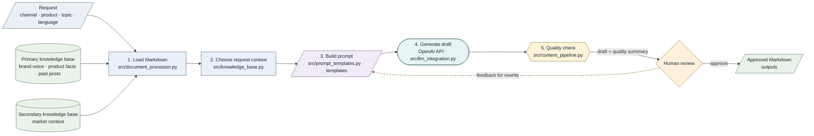

# AI Content Creator

A content-generation tool for Canyon Bicycles. Marketers choose a channel, product family, topic, and language; the app uses Canyon's knowledge base and prompt templates to create a draft. A person reviews the draft, can request a rewrite, and approves the version saved to `outputs/`.

**Channels:** LinkedIn, email, Instagram, newsletter · **Products:** gravel, road, mountain · **Languages:** English, German, French, Spanish

---

## How it works (process map)



**Shape and color key:** parallelograms are request and file inputs/outputs; cylinders are knowledge-base sources; rectangles are Python steps; the stadium is the OpenAI API call; the hexagon is the quality check; the diamond is the human decision. Colors distinguish those roles. This is option 6 from the process-map notebook: the quality summary is shown as information for the human reviewer, not as an approval decision.

| Step | What happens | Code | Card / Must |
|---|---|---|---|
| 1 | Load Markdown knowledge | `src/document_processor.py` | 3.1 · M1, M2 |
| 2 | Choose request context | `src/knowledge_base.py` | 3.2 · M3 support |
| 3 | Build the channel and language prompt | `src/prompt_templates.py`, `templates/` | 4.2 · M4 |
| 4 | Generate a draft | `src/llm_integration.py` | 4.1 · M3 |
| 5 | Check, review, revise, and save | `src/content_pipeline.py`, `src/main.py` | 4.3 · M5 |

The style check reports issues for human review. It does not establish factual accuracy. Feedback requests another draft; approval saves the reviewed draft.

**Recorded local checks:** document processor, knowledge base, prompt templates, CLI usage, and Gradio app import passed. The recorded checks did not include a live LLM request.

## Uniqueness evidence

[uniqueness/comparison.md](uniqueness/comparison.md) compares five paired requests across the three product families and four channels. It reports examples where the project pipeline uses more product-specific, knowledge-base-traceable details, alongside style, length, and qualification failures. This is illustrative evidence, not a publication-readiness result or a claim of universal superiority.

## Knowledge-selection approach

The current pipeline uses rules to select knowledge-base content and inserts it into the prompt. It does not use an embedding index or vector database. See [rag_decision.md](rag_decision.md) for the decision, implementation details, limits, and conditions for revisiting it.

## Setup

1. Use Python 3.12.
2. From the repository root, install dependencies:
   ```bash
   pip install -r requirements.txt
   ```
3. Copy `.env.example` to `.env` in the repository root and add `OPENAI_API_KEY`. The optional `LLM_MODEL` setting defaults to `gpt-4o-mini`. Keep `.env` local; do not commit it.

## Run the CLI

Run from the repository root with a channel, product, topic, and optional language:

```bash
python src/main.py linkedin gravel "autumn gravel season" German
```

The usage is `python src/main.py <channel> <product> "<topic>" [language]`. Supported channels are email, Instagram, LinkedIn, and newsletter. Products are gravel, road, and mountain. Languages are English, German, French, and Spanish; the default is English. Press Enter to approve and save, or enter feedback to request a rewrite.

## Run the Gradio app locally

From the repository root, run:

```bash
python src/app.py
```

Open [http://localhost:7860](http://localhost:7860). The interface supports draft generation, editing, rewrites with feedback, quality review, and approval for saving.

## Live app on Render

A Render deployment URL and deployment status are not recorded in this repository. Add the confirmed URL here if the app is deployed.

## Repository map

Must IDs refer to requirements in [project_structure.md](project_structure.md), section 4.

```text
src/
├── app.py                         # Gradio app
├── content_pipeline.py            # M5 — end-to-end pipeline
├── document_processor.py          # M1, M2 — ingest KB Markdown
├── knowledge_base.py              # M3 support — select context
├── llm_integration.py             # M3 — call LLM with KB context
├── main.py                        # M5 — CLI entry point
└── prompt_templates.py            # M4 — channel templates and languages
knowledge_base/
├── primary/                       # M1 — primary knowledge base
│   ├── brand_guidelines.md
│   ├── past_content/
│   │   ├── post_gravel_grail_gen3.md
│   │   ├── post_mountain_spectral_cf.md
│   │   └── post_road_ultimate_gen5.md
│   └── product_specs.md
└── secondary/                     # M2 — secondary knowledge base
    ├── competitor_analysis.md
    └── market_trends.md
templates/                         # M4 — prompt templates
├── banned_phrases.txt
├── email.txt
├── instagram.txt
├── linkedin.txt
├── newsletter.txt
└── system.txt
outputs/                           # M5 — approved drafts
logs/feedback.jsonl                # Feedback log
uniqueness/comparison.md           # M6 — comparison evidence
rag_decision.md                    # M7 — retrieval decision
project_structure.md               # M8 — project structure
agents.md                          # M8 — coding-agent guidance
requirements.txt
.env.example
```
## Knowledge-base format

Each knowledge-base Markdown file starts with a title, source and collection date, then topic sections with factual bullets:

```markdown
# Title
Source: <url> · Collected: YYYY-MM-DD

## Topic heading
- Fact
- Fact
```

In `product_specs.md`, each `##` heading starts with its product family, such as `## Gravel: ...`, `## Road: ...`, or `## Mountain: ...`.

## Quality check

The shared `templates/banned_phrases.txt` list is checked along with em dashes, Markdown heading/bold markers, emoji count (maximum 2), hashtag count (maximum 3), and word count. LinkedIn drafts are checked against 120–200 words and email drafts against 120–180 words. Other channels have no word-count range in the current checker. A failed check is reported for human review; a passing check does not establish factual accuracy.

## Feedback log

The Gradio app appends Generate, Rewrite, and Approve actions to `logs/feedback.jsonl` as JSON Lines. Each record includes a UTC timestamp, action, channel, product, language, topic, feedback text, `quality_ok`, and word count. The log file is created on the first interaction.

## How we work as a team

- **Plan:** [project_structure.md](project_structure.md) describes the project, requirements, work breakdown, and risks.
- **Board:** Trello cards use WBS numbers and Must IDs.
- **Git:** work on a named branch, pull from `main`, push, then open a pull request into `main` for review and merge.
- **Coding agents:** read [agents.md](agents.md) first and work on one Trello card and Must ID per prompt.

## Contributors and project cards

| Contributor | Branch |
|---|---|
| Ayhan | `ayhan` |
| Jaime | `jaime` |
| Friedrich | `friedrich` |

The project work breakdown includes these cards:

| Card | Work |
|---|---|
| 5.1 | Finalize the RAG decision and project-structure section |
| 5.2 | Feedback, additional templates, languages, quality check, and Gradio app |
| 5.3 | README and demo preparation |
| 5.4 | Day 1 / Day 2 board screenshots |
| 5.5 | Render deployment |

## Demo evidence

- Day 1 board screenshot: [docs/screenshot day1.png](docs/screenshot%20day1.png)
- Day 2 board screenshot: [docs/Screenshot day2.png](docs/Screenshot%20day2.png)
- A demo plan is not included in the repository.

## Implemented Day 2 features

The app includes feedback and improvement, Instagram and newsletter templates, four output languages, a quality check, and a Gradio interface. See the sections above for how to run and review generated drafts.
