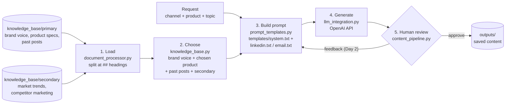

# AI Content Creator

An AI that writes marketing content in one company's voice, using only the company's own facts. A marketer picks a **channel**, a **product** and a **topic**; the app builds a prompt from two knowledge bases and an LLM writes the draft. A human reviews it before it is saved.

**Demo client:** Canyon Bicycles · **Channels:** LinkedIn, email (Instagram on Day 2) · **Products:** gravel, road, mountain bikes

The project is organisation-agnostic: replace the files in `knowledge_base/` and it writes for any company.

---

## How it works (process map)



| Step | File | What it does | Card | Must |
|---|---|---|---|---|
| 1. Load | `src/document_processor.py` | Finds every `.md` file in both KB folders, splits at `##` headings, labels each piece (folder, file, heading, date) | 3.1 | M1, M2 |
| 2. Choose | `src/knowledge_base.py` | Picks the pieces this request needs: brand voice always, only the chosen product, past posts, all secondary | 3.2 | supports M3 |
| 3. Build prompt | `src/prompt_templates.py` + `templates/` | Fills the system rules and the channel template with the request and the chosen pieces | 4.2 | M4 |
| 4. Generate | `src/llm_integration.py` | Sends the prompt to OpenAI, returns the draft, clear errors for key, model and network | 4.1 | M3 |
| 5. Review + save | `src/content_pipeline.py` + `src/main.py` | Runs steps 1 to 4, asks the human to approve or give feedback, saves to `outputs/` | 4.3 | M5 |

**Uniqueness proof (M6):** the same 3 requests (one per product), once with generic ChatGPT and once with our system, side by side in `uniqueness/comparison.md`.

**RAG decision (M7):** we inject the knowledge base into the prompt; no retrieval. Why: see `rag_decision.md`.

---

## Setup

1. Python 3.12 (3.8+ works)
2. Clone the repo and install the libraries:
   ```bash
   git clone <repo-url>
   cd ai-content-creator
   pip install -r requirements.txt
   ```
3. Create `.env` in the repo root (copy `.env.example`) and add your own key:
   ```
   OPENAI_API_KEY=sk-...
   LLM_MODEL=gpt-4o-mini
   ```
   `.env` is in `.gitignore` and is never committed.

## Run

```bash
python src/main.py <channel> <product> "<topic>"
```

Example:
```bash
python src/main.py linkedin gravel "autumn gravel season"
```

- `channel`: `linkedin` or `email` (`instagram` from Day 2)
- `product`: `gravel`, `road` or `mountain`
- Press **Enter** to approve and save the draft to `outputs/`, or type feedback to get a rewrite (Day 2)

Check single steps on their own:
```bash
python src/llm_integration.py     # LLM answers (card 4.1)
python src/document_processor.py  # KB loads, every piece has a heading (card 3.1)
python src/knowledge_base.py      # right pieces for gravel, road, mountain (card 3.2)
```

---

## Repo map

```
ai-content-creator/
├── src/
│   ├── document_processor.py   # 1. Load: reads and splits the markdown KBs
│   ├── knowledge_base.py       # 2. Choose: picks the pieces per request
│   ├── prompt_templates.py     # 3. Build prompt: fills the templates
│   ├── llm_integration.py      # 4. Generate: the only file that calls OpenAI
│   ├── content_pipeline.py     # 5. Runs steps 1 to 4, human review, saves
│   └── main.py                 # Entry point (command line)
├── knowledge_base/
│   ├── primary/                # Company: brand_guidelines.md, product_specs.md, past_content/
│   └── secondary/              # Industry: market_trends.md, competitor_analysis.md
├── templates/                  # system.txt + one template per channel
├── outputs/                    # Approved content
├── uniqueness/                 # Generic AI vs our system, side by side
├── requirements.txt
├── agents.md                   # Rules for coding agents (Codex)
├── project_structure.md        # Project plan: goal, stakeholders, Musts, WBS, risks
└── rag_decision.md             # Inject vs retrieve, and why
```

### Knowledge base format
Every KB file follows the same format, so the loader can split it:

```markdown
# File title
Source: https://... · Collected: YYYY-MM-DD

## Topic heading
- Fact
- Fact
```

In `product_specs.md`, every heading starts with the product family: `## Gravel: ...`, `## Road: ...`, `## Mountain: ...`. The chooser uses this to pick the right product.

---

## How we work as a team

- **Plan:** `project_structure.md` (Musts M1 to M8, WBS, risks)
- **Board:** Trello, lists Backlog → Ready → In progress (WIP: 2) → Review → Done; every card has a WBS number and a Must ID
- **Git:** everyone works on their own branch (`ayhan`, `jaime`, `friedrich`), never on `main`
  ```bash
  git pull origin main                 # before you start
  git add <files>
  git commit -m "add markdown loader"  # say what changed
  git push
  ```
  Then open a pull request into `main`; Ayhan (repo owner) reviews and merges.
- **Coding agents:** read `agents.md` first; one Trello card + Must ID per prompt

---

## Day 2 additions
- Feedback and improvement loop: the marketer's feedback rewrites the draft; feedback is logged
- Instagram template
- Gradio app: the same steps on screen (channel, product, topic, Generate, Feedback, Approve)
